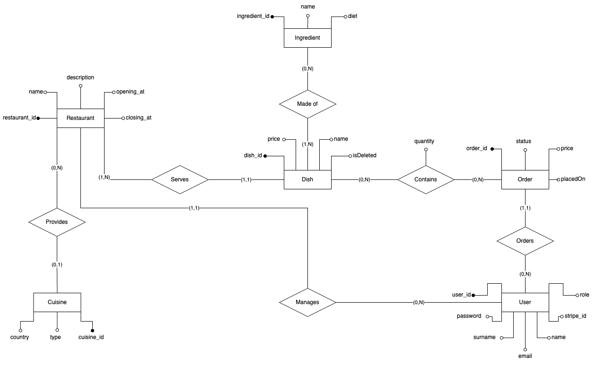
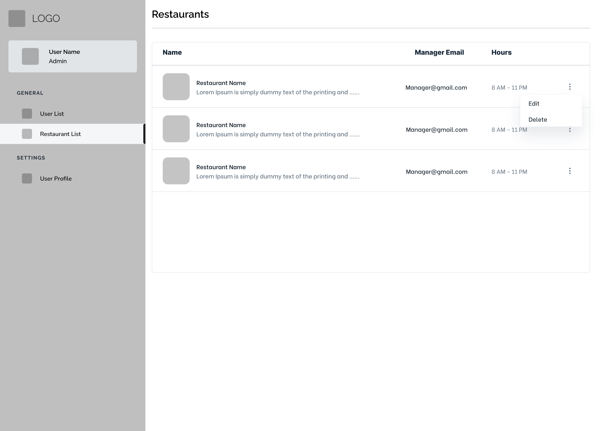
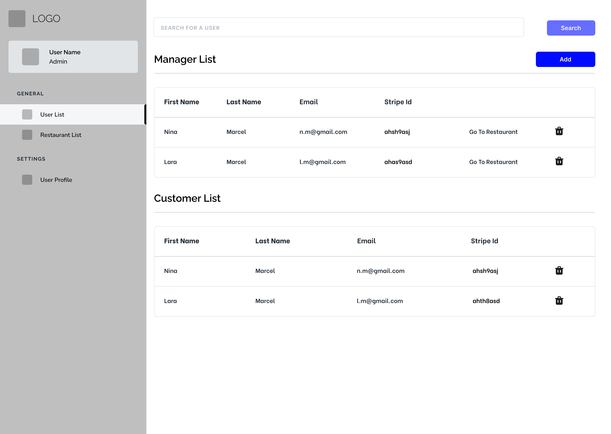
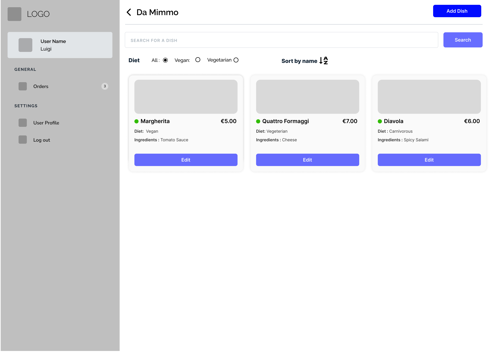
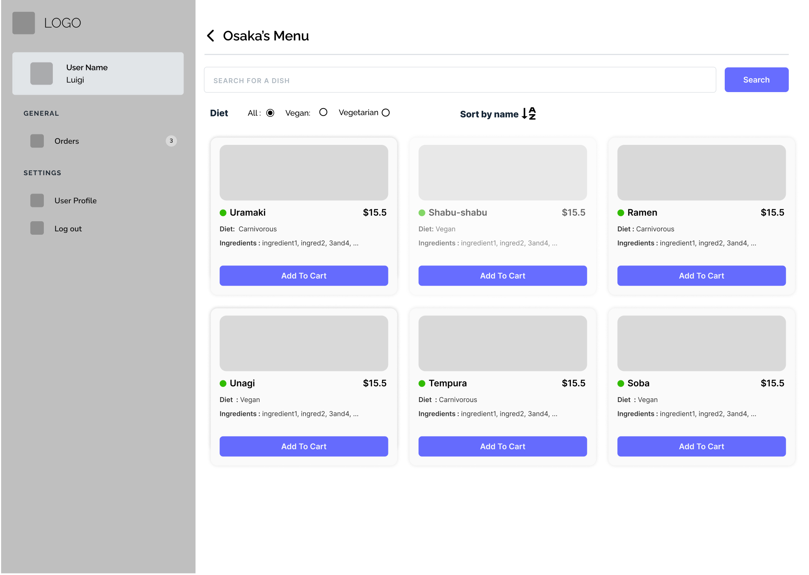

# PL8S: Festival Food Ordering Web Application

PL8S is a web application for ordering food at a festival. A visitor browses the restaurants and their menus, fills a single cart with dishes from several restaurants, and pays online, so there is no queue at the counter.

Group project for the course *Web Applications*, Department of Information Engineering, University of Padova (A.Y. 2023/2024).

## Features

The application has three roles, with one login page that redirects each user to the right view.

| Role | What the user can do |
|------|----------------------|
| Customer | Search restaurants by name and cuisine, search dishes by name and diet, manage a cart, pay by card, see previous orders |
| Restaurant manager | See the restaurants they manage, add, edit and remove dishes |
| Festival admin | Create and remove restaurants, create manager accounts, list and manage users |

## Architecture

| Layer | Technology |
|-------|------------|
| Front end | JSP, HTML, CSS, JavaScript |
| Back end | Java 17 servlets on Tomcat 10.1, REST API with JSON (Jackson), JWT authentication |
| Data | PostgreSQL, accessed through DAO classes and SQL functions |
| Payments | Stripe |
| Build and deployment | Maven, Docker Compose |

Docker Compose runs four services: `web` (Tomcat with the application), `db` (PostgreSQL), `pgadmin` (database interface) and `stripe` (Stripe CLI, which forwards payment events to the application).

### Database



### Interface mockups

The interface was designed in Figma before the implementation.

| Admin: restaurant list | Admin: user list |
|---|---|
|  |  |

| Admin: dish list | Customer: menu |
|---|---|
|  |  |

More mockups are in [`docs/images/mockups`](docs/images/mockups), and the class and sequence diagrams are in [`docs/images/diagrams`](docs/images/diagrams). The course presentation is in [`docs/presentation.pdf`](docs/presentation.pdf).

## Repository structure

```
code/
  PL8S/                  Maven project
    src/main/database/   SQL schema, functions and sample data
    src/main/java/       DAO classes, REST resources, filters, servlets
    src/main/webapp/     JSP pages, JavaScript, CSS
  dockerfiles/           Dockerfiles for web, db and pgadmin
  env/                   Environment files for the containers
  compose.yaml
docs/                    Diagrams, mockups and presentation
```

## Running the application

Requirements: Docker with Docker Compose.

```
cd code
for f in env/*.env.example; do cp "$f" "${f%.example}"; done
docker compose build
docker compose up web
```

- Application: `http://localhost/pl8s`
- pgAdmin (after `docker compose up pgadmin`): `http://localhost:8080`

The database is created and filled with sample data the first time the `db` service starts. To start again from an empty database, run `make clean_db`.

### Stripe keys

The Stripe keys have been removed from this public copy. Registration and payments call Stripe, so they need valid keys. To use them, create a Stripe test account and set your own test keys in:

- `code/env/stripe.env` (secret key)
- `code/PL8S/src/main/java/it/unipd/dei/webapp/wa001/resource/StripeService.java` (secret key)
- `code/PL8S/src/main/java/it/unipd/dei/webapp/wa001/filter/StripeResourceFilter.java` (webhook secret)
- `code/PL8S/src/main/webapp/js/checkout.js` (publishable key)

The database passwords and the JWT signing key in this repository are for local development only.

### Testing the REST API

`code/pl8s_postman_collection.json` and `code/pl8s_postman_environment.json` can be imported into Postman. The environment contains the credentials of the three sample users (admin, manager, customer). Call the Login request first and store the returned JWT in the matching token variable.

## Team

The project was developed by a team of five: Manuel Antonutti, Daniel Carlesso, Luigi Frigione, Mahshid Shams and Nicola Ursino.

**My contribution (Mahshid Shams):**

- Designed the user experience and the Figma mockups for the restaurant and dish pages and for the admin and manager views.
- Implemented `ListUsersDAO` and the list-users REST resource (`ListUsersRR`).
- Wrote the documentation of the manager views.
- Took part in the ER design of the database with the rest of the team.

The other parts of the code were written by the other team members.

This repository is a copy of the course repository, with the Stripe keys and personal data removed.
